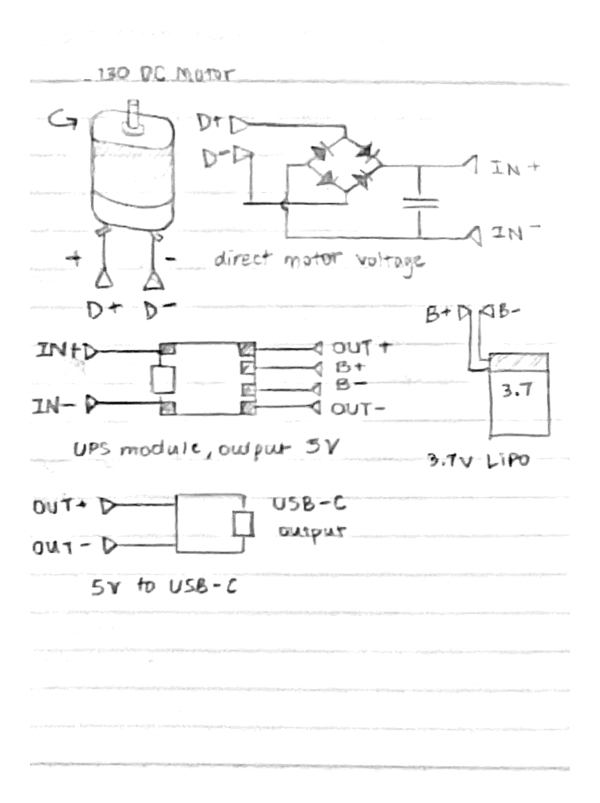

## sorry, my phone's dead

A dynamo (type of generator) for charging my phone, which is chronically dead.

## CAD

version 2:

## how does it work?

The principle of a dynamo is based on backdriving a motor. There are lots of little copper wire windings inside of a motor, and running a current through there creates an electromagnetic field. That causes the magnets in the motor to want to spin, essentially.

This also works the other way: **spinning the motor shaft also changes the electromagnetic field**. This is the principle of many generators.

To get 5V out of it, we have to crank it **really fast**, through a gear train or some other gear-ratio-like system. I'm using a 130 motor, so we’d have to get the motor spinning at about 15000 RPM / 60 = 250 RPS.

## wiring

The voltage generated will be positive or negative, and anywhere between neg/pos 2-9V. 
The circuit first converts it to conventional "positive", then steps it down to a steady 5V, with extra power stored in the battery.

When the generator isn't providing at least 5V, the 5V output is taken from the stored battery power.

